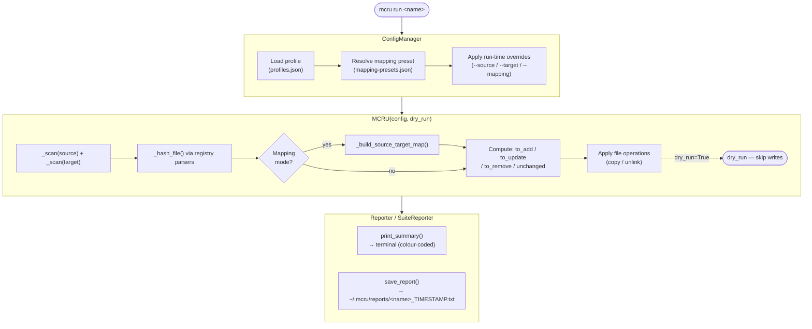

# mcru — Architecture & Program Reference

A detailed technical reference for [mc-recipe-updater](../README.md).  
Intended as a developer/maintainer guide and personal Obsidian reference.

---

## What the Program Does

`mcru` is a terminal tool that compares a **source** folder to a **target** folder and syncs them so that the target mirrors the source. Source is always treated as the authoritative version.

Sync operations performed:
- **Add** files present in source but missing from target
- **Update** files present in both but with differing content (source wins)
- **Remove** files present in target but absent from source
- **Create** empty directories found in source but missing from target
- **Remove** empty orphan directories in target that no longer exist in source

The tool supports two sync modes:

| Mode        | Description                                                                                                                                     |
| ----------- | ----------------------------------------------------------------------------------------------------------------------------------------------- |
| **Default** | Direct path-mirroring. `source/foo/bar.json` → `target/foo/bar.json`                                                                            |
| **Mapping** | Category-aware routing. Source folders are categorised (e.g. `common`, `fabric`, `forge`) and files are placed into mapped target root folders. |

### Sync Root Validation

The shared sync engine resolves the source and target paths before syncing. The source must be an existing directory; if the target already exists, it must also be a directory. Resolved roots are rejected if they are identical or overlap because one is inside the other. The engine itself permits a target that does not yet exist.

Entry points retain their own missing-target policies: `mcru run` requires an existing target, and a suite skips profiles whose target is missing; `mcru quick` may create a missing target. The TUI requires both source and target paths to exist as directories before starting a run.

---

## Module Overview

```
cli.py              Entry point. All Click commands live here (CLI only).
config.py           ConfigManager — reads/writes profiles, suites, and mapping presets.
syncer.py           MCRU — the diff + sync engine.
reporter.py         Reporter / SuiteReporter — terminal output and .txt report files.
registry.py         Parser registry — content transform functions (bytes → bytes).
tui/                TUI layer — interactive terminal interface (new, see below).
mapping-presets.json  Bundled default mapping presets, seeded to ~/.mcru/ on first run.
setup.py            Package definition, entry point registration (CLI & TUI).
```

---

## Module Details

### `cli.py` — Command Layer

Built with [Click](https://click.palletsprojects.com/). Defines all user-facing commands as a `@click.group()` tree.

**Command groups:**
- `cli` — root group (`mcru`)
- `cli.config` — config management subcommands
- `cli.suite` — suite management subcommands

**Command routing logic in `run`:**  
1. Looks up the argument as a **profile** first.  
2. If the profile is not found, looks it up as a **suite**.  
3. Runs the appropriate path (single profile or sequential suite iteration).  
4. Passes runtime overrides (`--source`, `--target`, `--mapping`) into the config dict before passing to `MCRU`. The saved profile is never mutated.

**Mapping resolution order in `run` / `quick`:**  
1. `--mapping` CLI flag (highest priority)
2. `mapping_preset` saved in the profile
3. No mapping (default behavior)

---

### `config.py` — Config Manager

**Class:** `ConfigManager`

Responsible for all read/write access to the `~/.mcru/` directory.

**Initialisation flow:**
1. Creates `~/.mcru/` if it does not exist.
2. Creates `profiles.json` with an empty `{"profiles": []}` stub if missing.
3. Creates `suites.json` with an empty `{"suites": []}` stub if missing.
4. Copies `mapping-presets.json` from the package bundle into `~/.mcru/` if the user copy does not yet exist.

**Key constants:**

| Constant               | Value                                |
| ---------------------- | ------------------------------------ |
| `CONFIG_DIR`           | `~/.mcru/`                           |
| `CONFIG_FILE`          | `~/.mcru/profiles.json`              |
| `SUITES_FILE`          | `~/.mcru/suites.json`                |
| `DEFAULT_MAPPING_FILE` | `~/.mcru/mapping-presets.json`       |
| `BUNDLED_MAPPING_FILE` | `<package_dir>/mapping-presets.json` |

**Profile schema:**

```json
{
  "name": "myproject",
  "source": "/absolute/path/to/source",
  "target": "/absolute/path/to/target",
  "parsers": ["normalize_line_endings"],
  "description": "Optional description",
  "created_at": "2026-02-26T12:00:00",
  "mapping_preset": "mc-arch"
}
```

- `source` and `target` are resolved to absolute paths at save time.
- `mapping_preset` is optional; omitted when not set.

**Suite schema:**

```json
{
  "name": "full-sync",
  "description": "Sync all mods in order",
  "created_at": "2026-02-26T12:00:00",
  "profiles": ["mod-a", "mod-b", "mod-c"]
}
```

- `profiles` is an **ordered** list of profile names.
- A profile can belong to multiple suites.
- The profile list is iterated in order at run time.

**Mapping preset resolution (`get_mapping_preset`):**
1. Checks `MCRU_MAPPING_FILE` environment variable.
2. Falls back to `~/.mcru/mapping-presets.json`.
3. Parses the JSON, locates the named preset, validates required keys, and returns a copy.

---

### `syncer.py` — Diff and Sync Engine

**Class:** `MCRU(config: dict, dry_run: bool)`

The config dict accepted by `MCRU`:

```python
{
  "source":   "/path/to/source",
  "target":   "/path/to/target",
  "parsers":  ["strip_bom", "normalize_line_endings"],  # optional
  "mapping":  { ... },  # optional — resolved preset dict, not preset name
}
```

**`run()` dispatch:**

```
MCRU.run()
  ├── mapping is set  → _run_with_mapping()
  └── no mapping      → _run_default()
```

**Default sync pipeline (`_run_default`):**

1. `_scan(source)` — builds `{rel_path: stat}` for all files under source.
2. `_scan(target)` — same for target.
3. Computes `to_add`, `to_update`, `to_remove`, `unchanged` by comparing the two dicts.
4. For `to_update`/`to_add`: calls `_hash_file()` to compare content (not mtime/size).
5. Applies file operations (copy/unlink) unless `dry_run=True`.
6. `_scan_all_dirs(source)` — creates missing source directories in target.
7. In live mode: removes empty orphan target directories (deepest-first).
8. In dry-run mode: flags directories that would be empty after file removals.

**Mapping sync pipeline (`_run_with_mapping`):**

1. `_build_source_target_map()` → produces `{target_rel_path: source_rel_path}` for all files.
2. Builds the inverse lookup of existing target files.
3. Computes add/update/remove/unchanged the same way as default.
4. Applies file operations. Directory creation/removal is not performed in mapping mode.

**Mapping resolution internals (`_build_source_target_map`):**

For each `(source_category, target_category)` pair in `category_map`:
1. `_resolve_source_dirs(category)` → resolves glob patterns against `self.source`, returns matching `Path` objects.
2. For `forge_like` category: resolves a list of `candidates` globs, applies `forge_like_conflict` rule (errors if more than one resolves).
3. For each file under each resolved source dir:
   - Checks `_is_omitted()` against `omit_globs`. Skips if matched.
   - Computes `target_rel = target_root / file.relative_to(source_dir)`.
   - Detects target path conflicts (two source files mapping to the same target path).

**File hashing (`_hash_file`):**

```
read bytes
  → apply each parser in order (bytes → bytes)
  → MD5 hex digest
```

Parsers are applied before hashing, so content normalisation does not produce false-positive diffs.

**Return dict schema (both modes):**

```python
{
  "added":       [rel_path, ...],
  "updated":     [rel_path, ...],
  "removed":     [rel_path, ...],
  "unchanged":   [rel_path, ...],
  "dirs_added":  [rel_dir, ...],   # default mode only
  "dirs_removed":[rel_dir, ...],   # default mode only
  "errors":      [(rel_path, error_message), ...],
}
```

---

### `reporter.py` — Output Formatting

**Classes:**

| Class           | Purpose                                               |
| --------------- | ----------------------------------------------------- |
| `Reporter`      | Single-profile terminal summary + `.txt` file         |
| `SuiteReporter` | Multi-profile terminal summary + combined `.txt` file |

**Terminal output:** Uses `click.style()` for colour-coded output:
- Green → added
- Yellow → updated
- Red → removed
- Bright red → errors

**Report files** are saved to `~/.mcru/reports/` with the naming pattern:  
`<profile-or-suite-name>_YYYYMMDD_HHMMSS.txt`

**Suite report structure:**
```
mcru Suite Report
=== header (suite name, date, mode, profile count) ===

--- per-profile block (source, target, add/update/remove/unchanged/errors) ---
--- per-profile block ---
...

=== SUITE TOTALS ===
Added    : N
Updated  : N
Removed  : N
Dirs added: N
Dirs removed: N
Unchanged: N
Errors   : N
```

---

### `registry.py` — Parser Registry

Parsers are pure functions with signature `(bytes) -> bytes`.  
They are applied in order in `MCRU._hash_file()` before the MD5 is computed.

**Built-in parsers:**

| Name                        | Function                             | What it does                                                  |
| --------------------------- | ------------------------------------ | ------------------------------------------------------------- |
| `strip_bom`                 | `strip_bom(content)`                 | Removes UTF-8 BOM (`\xef\xbb\xbf`) from the start of the file |
| `normalize_line_endings`    | `normalize_line_endings(content)`    | Converts `\r\n` and `\r` to `\n`                              |
| `strip_trailing_whitespace` | `strip_trailing_whitespace(content)` | Strips trailing whitespace from each line                     |

> Note: `lowercase_names` is shown as a parser option in CLI help text but is not currently implemented in the registry — it is listed for future use.

**Adding a custom parser:**

1. Write your function in `registry.py`:
   ```python
   def my_parser(content: bytes) -> bytes:
       # transform and return
       return content
   ```
2. Register it in the `PARSERS` dict:
   ```python
   PARSERS = {
       ...
       "my_parser": my_parser,
   }
   ```
3. Expose it in the CLI by adding it to the `click.Choice` list in `cli.py`.

---

### `tui/` — TUI Layer (Interactive Terminal Interface)

The TUI module provides an alternative interactive interface to the CLI, powered by [Textual](https://textualize.io/textual/).

**Module structure:**
```
tui/
├── __init__.py          Package marker
├── main.py              Entry point: run() function
├── app.py               MCRecipeApp — root Textual App class
├── utils.py             ThreadedSyncer, formatting helpers
├── screens/
│   ├── __init__.py
│   ├── home.py          Home screen with command navigation and ASCII art
│   ├── profiles.py      Profile management (Phase 2)
│   ├── suites.py        Suite management (Phase 3)
│   ├── run_profile.py   Sync execution with progress (Phase 4)
│   ├── reports.py       Report viewing (Phase 5)
│   ├── backups.py       Backup management
│   └── config.py        Configuration screen (Phase 6)
└── widgets/
    ├── __init__.py
    ├── result_table.py  Sync results display (Phase 4)
    ├── progress_spinner.py  Async progress indicator (Phase 4)
    └── profile_selector.py  Profile dropdown (Phase 2)
```

**Key architecture decisions:**

1. **Reuse of business logic** — All TUI screens use the same `ConfigManager`, `MCRU`, and `Reporter` classes as the CLI. No duplication of core functionality.

2. **Threading for responsiveness** — `ThreadedSyncer` in `utils.py` wraps sync operations in background threads. Textual's message system ensures thread-safe UI updates.

3. **Screen-based navigation** — Each major feature (profiles, suites, run, reports, config) is a Textual `Screen`. The `MCRecipeApp` manages screen stacks with `push_screen()` / `pop_screen()`.

4. **Entry point** — Registered in `setup.py` as `mcru-tui=tui.main:run`. Launches the root `MCRecipeApp`.

**Threading model:**

```
TUI Screen (main thread)
  ↓
  User clicks "Run Sync"
  ↓
  ThreadedSyncer.start() → spawns background thread
  ↓
  Background thread calls MCRU.run()
  ↓
  Results posted to Textual message queue
  ↓
  Main thread updates UI (progress bar, result summary)
```

**Comparison: CLI vs TUI data flow**

| Aspect | CLI (`cli.py`) | TUI (`tui/`) |
|--------|---|---|
| Entry point | Click group commands | Textual App |
| Profile loading | Click command handler | Screen initialization |
| Config access | ConfigManager | ConfigManager (shared) |
| Sync execution | Synchronous (blocks terminal) | Async thread (responsive UI) |
| Output | Text + colored terminal | Widgets + color scheme |
| Report persistence | Reporter writes `.txt` | Reporter writes `.txt` (shared) |

For detailed TUI-specific documentation, see [docs/tui.md](../tui.md).

---

## Data Flow Diagram (CLI)



---

## Storage Layout

All user data lives under `~/.mcru/`, created automatically on first use.

```
~/.mcru/
├── profiles.json          All saved profiles
├── suites.json            All saved suites
├── mapping-presets.json   Mapping presets (seeded from package, freely editable)
└── reports/
    ├── myproject_20260226_120000.txt
    └── full-sync_20260226_130000.txt
```

**Seeding behaviour:**  
`mapping-presets.json` is copied once from the bundled package defaults.  
Subsequent installs or upgrades never overwrite the user copy.  
To reset: `mcru config reset-presets`  
To reset everything: `mcru config reset` (deletes all of `~/.mcru/`)

**Environment variable override:**  
Set `MCRU_MAPPING_FILE` to use a mapping file at an arbitrary path.

---

## Packaging & Entry Point

Defined in `setup.py`:

```python
entry_points={
    "console_scripts": [
        "mcru=cli:cli",
    ],
}
```

After `pip install -e .`, the `mcru` command is available globally.  
Editable install means source changes take effect immediately without reinstalling.

**Standalone binary (optional):**
```bash
pip install pyinstaller
pyinstaller --onefile cli.py --name mcru
# Output: dist/mcru  — single binary, no Python required
```

**Requirements:**
- Python >= 3.10
- `click >= 8.0`

---

## Command Reference (Full)

### Profile Commands

| Command                                 | Description                          |
| --------------------------------------- | ------------------------------------ |
| `mcru add <name> <src> <tgt> [opts]`    | Save a new sync profile              |
| `mcru list`                             | List all saved profiles              |
| `mcru remove <name>`                    | Delete a profile                     |
| `mcru update <name> <src> <tgt> [opts]` | Overwrite an existing profile        |
| `mcru run <name> [opts]`                | Run a profile (or suite)             |
| `mcru quick <src> <tgt> [opts]`         | One-off run without saving a profile |

**`add` / `update` options:**
- `-p / --parser` — parser name (repeatable): `strip_bom`, `normalize_line_endings`, `lowercase_names`
- `-d / --desc` — description
- `--mapping` — mapping preset name

**`run` options:**
- `--dry-run` — preview only, no files written
- `--no-report` — skip saving the `.txt` report
- `--source <path>` — override source for this run
- `--target <path>` — override target for this run
- `--mapping <preset>` — override mapping preset for this run

---

### Suite Commands

| Command                                       | Description                           |
| --------------------------------------------- | ------------------------------------- |
| `mcru suite add <name> [-d desc]`             | Create an empty suite                 |
| `mcru suite remove <name>`                    | Delete a suite (profiles unaffected)  |
| `mcru suite update <name> -d <desc>`          | Update suite description              |
| `mcru suite list`                             | List all suites                       |
| `mcru suite show <name>`                      | Show ordered profile list for a suite |
| `mcru suite add-profile <suite> <profile>`    | Append a profile to a suite           |
| `mcru suite remove-profile <suite> <profile>` | Remove a profile from a suite         |
| `mcru suite reorder <suite> <profile> <pos>`  | Move a profile to a 1-based position  |

See [suites.md](suites.md) for detailed suite documentation.

---

### Config Commands

| Command                     | Description                                          |
| --------------------------- | ---------------------------------------------------- |
| `mcru config show`          | Print paths of all config files                      |
| `mcru config open`          | Open `~/.mcru/` in the file explorer                 |
| `mcru config reset-presets` | Re-seed `mapping-presets.json` from package defaults |
| `mcru config reset`         | Delete all `~/.mcru/` data and re-initialise         |

---

## Mapping Presets Reference

See [folder-mapping.md](folder-mapping.md) for the full mapping documentation.

### Preset schema keys

| Key            | Type   | Description                                                   |
| -------------- | ------ | ------------------------------------------------------------- |
| `description`  | string | Human-readable description                                    |
| `source_roots` | object | Maps category name → glob pattern(s) or `{candidates: [...]}` |
| `target_roots` | object | Maps category name → target root folder string                |
| `category_map` | object | Maps source category → target category                        |
| `omit_globs`   | array  | Glob patterns; matched source files/folders are skipped       |
| `rules`        | object | Behaviour flags (see below)                                   |

### `rules` flags

| Key                   | Value                 | Behaviour                                                          |
| --------------------- | --------------------- | ------------------------------------------------------------------ |
| `forge_like_conflict` | `"error_if_multiple"` | Error if both forge and neoforge candidates resolve simultaneously |
| `delete_mode`         | `"global_target"`     | Target files not present in any mapped source are deleted          |

### Bundled presets

| Preset                  | Description                                                                                       |
| ----------------------- | ------------------------------------------------------------------------------------------------- |
| `mc-arch`               | Maps `common/fabric/forge_like` source to `core/fabric/forge` target folders                      |
| `mc-arch-recipes-split` | Variant: nested `recipes/core`, `recipes/fabric`, `recipes/forge` targets with example omit globs |

---

## Error Handling

| Scenario                            | Behaviour                                                      |
| ----------------------------------- | -------------------------------------------------------------- |
| Source missing or not a directory   | Validation error raised before any sync begins                 |
| Existing target is not a directory  | Validation error raised before any sync begins                 |
| Resolved roots are identical/overlap | `ValueError` raised before any sync begins                     |
| Mapping preset not found            | Error printed, command exits cleanly                           |
| Forge + neoforge both present       | Error if `forge_like_conflict: error_if_multiple`              |
| Two source files map to same target | `ValueError` raised with both conflicting paths named          |
| Profile not found in suite          | Profile is skipped with a warning; remaining profiles continue |
| File copy/delete failure            | Error recorded in results `errors` list; shown in report       |
